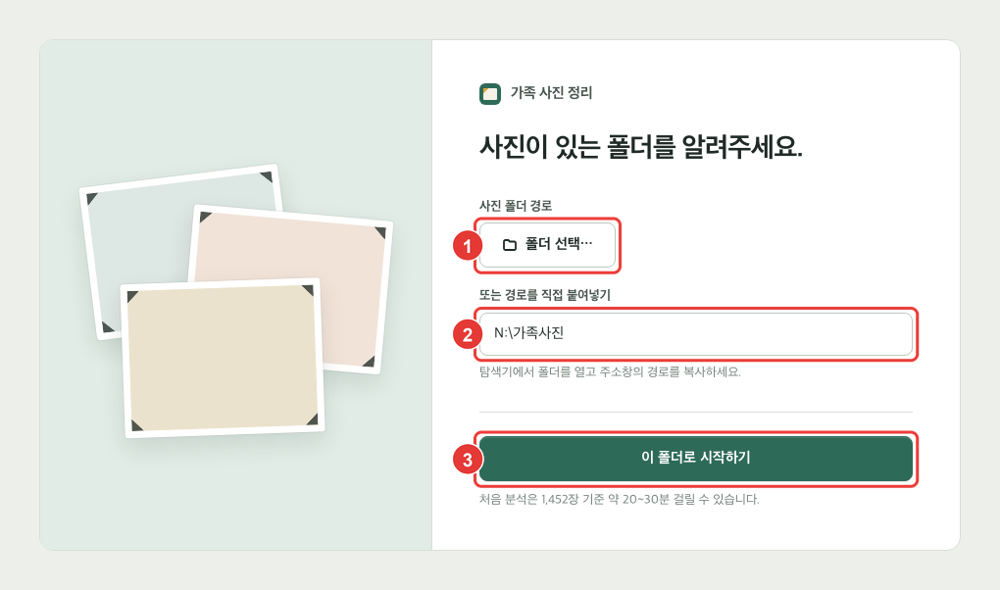
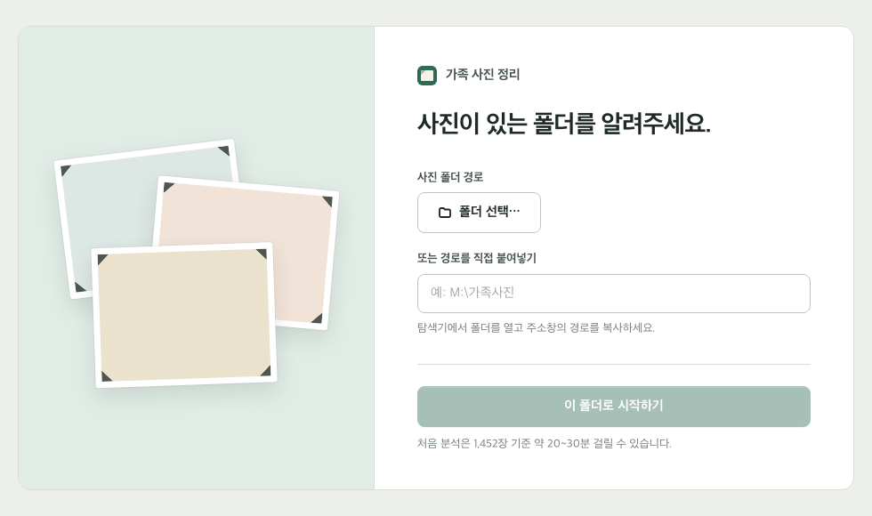
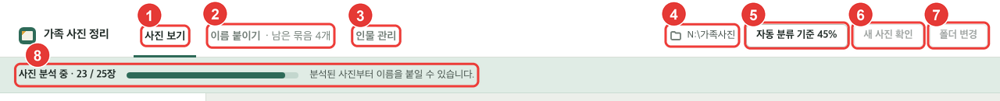
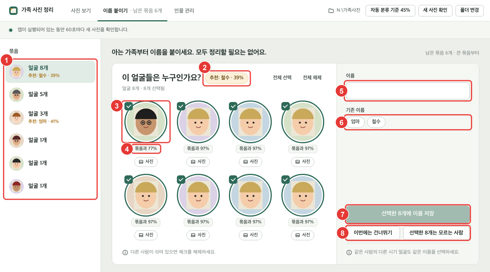
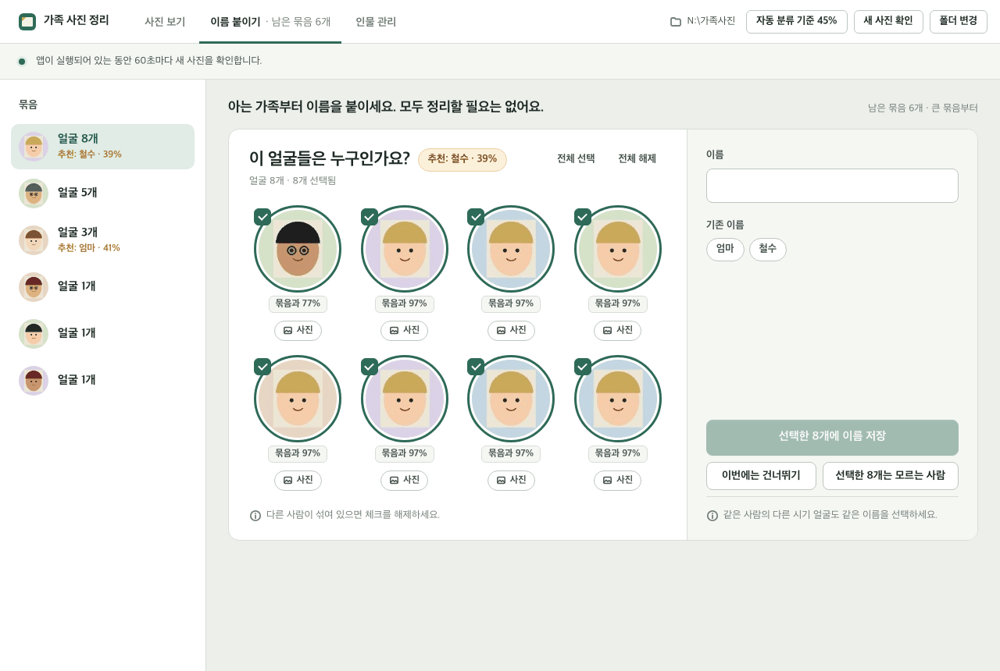
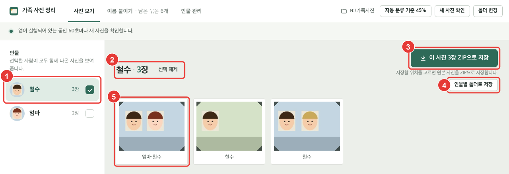
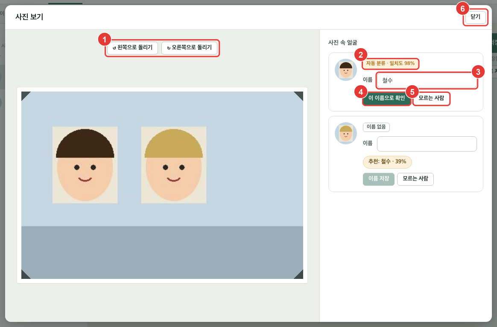
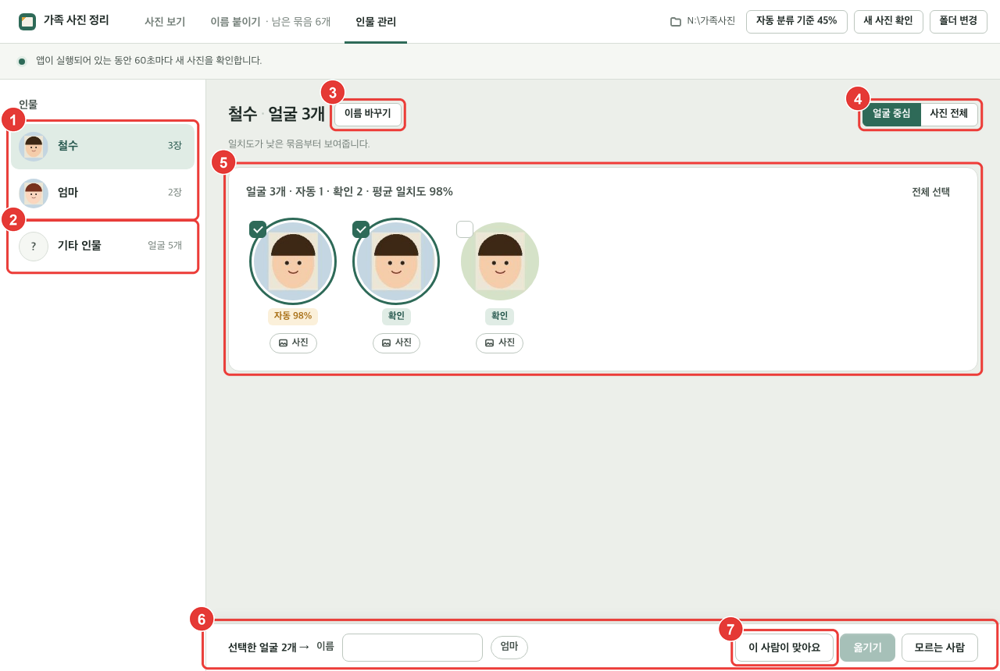

# 가족 사진 정리 사용 설명서 (Windows)

가족 사진 정리는 MYBOX에 있는 가족 사진에서 얼굴을 찾아 **사람별로 정리**해 주는 Windows 프로그램입니다. 이 설명서는 설치부터 기능별 사용법, 문제 해결까지 다룹니다. 그림 속 사진과 이름은 설명을 위해 만든 가짜입니다.

## 목차

1. [시작하기 전에](#1장-시작하기-전에)
2. [설치](#2장-설치)
3. [처음 실행과 사진 폴더 설정](#3장-처음-실행과-사진-폴더-설정)
4. [화면 구성](#4장-화면-구성)
5. [이름 붙이기](#5장-이름-붙이기)
6. [사진 보기와 저장](#6장-사진-보기와-저장)
7. [인물 관리](#7장-인물-관리)
8. [설정과 관리](#8장-설정과-관리)
9. [문제 해결](#9장-문제-해결)
10. [부록: ChatGPT에 붙여 넣을 안내 글](#부록-chatgpt에-붙여-넣을-안내-글)

---

## 1장 시작하기 전에

### 1.1 이 프로그램으로 할 수 있는 일

- 사진 속 얼굴을 찾아 비슷한 얼굴끼리 묶어 보여 줍니다.
- 몇 명에게 이름을 붙이면 나머지 사진은 자동으로 그 사람으로 분류합니다.
- 사람을 골라 그 사람이 나온 사진만 보고, ZIP이나 인물별 폴더로 저장합니다.
- MYBOX에 새 사진이 올라오면 프로그램이 켜져 있는 동안 1분마다 알아서 찾아 분류합니다.

### 1.2 필요한 것

| 항목 | 내용 |
| --- | --- |
| 운영체제 | Windows 10 64bit 이상 |
| 인터넷 | 처음 설치할 때 프로그램과 얼굴 인식 자료(약 300MB)를 받습니다. MYBOX 사진을 읽을 때도 필요합니다 |
| 네이버 계정 | MYBOX 탐색기 로그인에 씁니다 |
| 디스크 여유 공간 | 2GB 이상 권장 (프로그램, 얼굴 인식 자료, 썸네일) |

### 1.3 사진과 개인정보

- 사진은 **읽기만** 합니다. 원래 사진은 바뀌거나 지워지지 않습니다.
- 얼굴 분석은 이 컴퓨터 안에서만 합니다. 사진을 인터넷 어디로도 보내지 않습니다.
- 붙인 이름과 분석 결과는 `person_cluster\data` 폴더에 저장됩니다.

---

## 2장 설치

아래 세 가지를 순서대로 설치합니다. ChatGPT를 먼저 설치해 [부록의 안내 글](#부록-chatgpt에-붙여-넣을-안내-글)을 붙여 넣으면, 나머지 설치를 ChatGPT가 한 단계씩 알려 줍니다.

| 순서 | 프로그램 | 내려받기 | 용도 |
| --- | --- | --- | --- |
| 1 | ChatGPT | [Microsoft Store](https://apps.microsoft.com/detail/9plm9xgg6vks?hl=ko-KR&gl=KR) | 설치가 막힐 때 물어보기 |
| 2 | MYBOX 탐색기 | [MYBOXInstaller.exe](https://appdown.pstatic.net/naver/mybox/installer/MYBOXInstaller.exe) | MYBOX 사진을 컴퓨터의 N: 드라이브로 보기 |
| 3 | 가족 사진 정리 | [person_cluster.zip](https://github.com/ssudaya0/family-photo-download/releases/latest/download/person_cluster.zip) | 얼굴 분류 프로그램 |

### 2.1 ChatGPT 설치

1. 위 표의 **Microsoft Store** 링크를 열고 **받기**를 누릅니다.
2. 설치가 끝나면 **열기** → 구글 계정 등으로 로그인합니다.
3. 부록의 안내 글을 복사해 붙여 넣습니다. 막힌 화면은 **Windows + Shift + S**로 찍어 **Ctrl + V**로 붙이면 됩니다.

### 2.2 MYBOX 탐색기 설치

1. **MYBOXInstaller.exe**를 받아 실행합니다. 변경 허용을 물으면 **예**를 누릅니다.
2. “네이버 MYBOX 탐색기를 설치합니다” 창에서 **다음 >** 버튼을 누릅니다.
3. “설치 위치 선택” 창에서 **설치** 버튼을 누릅니다.
4. “MYBOX 탐색기를 시작합니다” 창에서 **NAVER 로그인** 버튼을 눌러 로그인합니다.
5. 파일 탐색기 왼쪽에 **MYBOX (N:)** 드라이브가 보이면 완료입니다.

> N: 드라이브는 컴퓨터 용량을 쓰지 않는 대신 사진을 열 때마다 인터넷에서 받습니다. 가족 사진 정리를 쓰는 동안에는 인터넷을 켜 두세요. MYBOX 설치 파일 링크는 [MYBOX 공식 다운로드 페이지](https://mybox.naver.com/about/explorer-guide/win)의 [다운로드 Win x64] 버튼과 같은 주소입니다.

### 2.3 가족 사진 정리 설치

1. **person_cluster.zip**을 받아 바탕 화면에 둡니다.
2. 마우스 오른쪽 버튼 → **모두 압축 풀기...** → **압축 풀기**. 바탕 화면에 **person_cluster** 폴더가 생깁니다.
3. 바탕 화면에 바로 가기를 두려면 폴더 안의 **start.bat**을 오른쪽 버튼 → **보내기** → **바탕 화면(바로 가기 만들기)**.

> person_cluster 폴더는 지우거나 옮기지 마세요. 붙인 이름이 이 안에 저장됩니다.

---

## 3장 처음 실행과 사진 폴더 설정

### 3.1 처음 실행

1. `person_cluster` 폴더의 `start.bat`(또는 바탕 화면 바로 가기)을 실행합니다.
2. “Windows에서 PC를 보호했습니다”가 나오면 **추가 정보** → **실행**을 누릅니다.
3. 검은 창이 뜨고, 처음 한 번은 필요한 파일을 받느라 5~15분 걸립니다. 검은 창은 닫지 마세요.
4. “가족 사진 정리” 창이 뜨면 그림 1의 화면이 나옵니다.

### 3.2 사진 폴더 설정



**그림 1. 사진 폴더 설정 화면**

| 번호 | 이름 | 설명 |
| --- | --- | --- |
| 1 | 폴더 선택… | Windows 폴더 선택 창을 엽니다 |
| 2 | 경로 칸 | 고른 폴더의 경로가 들어갑니다. 경로를 직접 붙여 넣어도 됩니다 |
| 3 | 이 폴더로 시작하기 | 사진 분석을 시작합니다 |

1. ① 폴더 선택… → 왼쪽에서 MYBOX (N:) → 가족 사진 폴더 → 폴더 선택을 누릅니다. ②에 경로가 채워집니다.
2. ③ 이 폴더로 시작하기를 누릅니다.
3. 분석이 시작됩니다. 맨 처음에는 얼굴 인식 자료(약 300MB)도 받습니다. 사진 1,000장에 30분쯤 걸리고, 분석된 사진부터 바로 쓸 수 있습니다.

가족 사진 폴더 하나만 고르면 그 안의 하위 폴더 사진까지 모두 찾습니다. 지원 형식은 JPG, PNG, HEIC입니다.

<details><summary>움직이는 예시 보기</summary>



</details>

---

## 4장 화면 구성

폴더를 정하면 항상 화면 위에 상단 바와 상태 표시가 보입니다.



**그림 2. 상단 바와 상태 표시 (분석 중)**

| 번호 | 이름 | 설명 |
| --- | --- | --- |
| 1 | 사진 보기 탭 | 사람별로 사진을 골라 보고 저장합니다 (6장). 처음 켜면 이 탭이 열립니다 |
| 2 | 이름 붙이기 탭 | 아직 이름이 없는 얼굴 묶음에 이름을 붙입니다 (5장). 남은 묶음 수가 함께 보입니다 |
| 3 | 인물 관리 탭 | 사람별 얼굴을 점검하고 옮기거나 이름을 바꿉니다 (7장) |
| 4 | 사진 폴더 경로 | 지금 분석하는 폴더입니다 |
| 5 | 자동 분류 기준 | 자동으로 이름을 붙이는 기준을 바꿉니다 (8.1절) |
| 6 | 새 사진 확인 | 60초를 기다리지 않고 바로 새 사진을 찾습니다 |
| 7 | 폴더 변경 | 다른 사진 폴더를 고릅니다. 붙인 이름은 보관됩니다 |
| 8 | 상태 표시 | 분석 진행률을 보여 줍니다. 분석하지 못한 사진이 있으면 건수와 오류 보기가 나옵니다 |

분석 중에는 새 사진 확인과 폴더 변경을 누를 수 없습니다. 분석이 끝나면 상태 표시는 “앱이 실행되어 있는 동안 60초마다 새 사진을 확인합니다.”로 바뀝니다.

---

## 5장 이름 붙이기

비슷한 얼굴끼리 묶인 묶음에 이름을 붙입니다. 아는 사람 몇 명만 붙이면 나머지 사진은 자동으로 분류되므로, 모두 정리할 필요는 없습니다.

### 5.1 화면 설명



**그림 3. 이름 붙이기 화면**

| 번호 | 이름 | 설명 |
| --- | --- | --- |
| 1 | 묶음 목록 | 큰 묶음부터 보입니다. 누르면 그 묶음으로 바뀝니다. 건너뛴 묶음은 아래에 흐리게 보입니다 |
| 2 | 추천 | 이미 이름을 붙인 사람과 닮았으면 이름과 일치도가 나옵니다. 누르면 이름 칸에 채워집니다 |
| 3 | 얼굴 | 체크된 얼굴만 저장됩니다. 다른 사람이면 눌러 체크를 풀면, 그 얼굴은 다시 이 사람으로 분류되지 않습니다 |
| 4 | 묶음과 ○% | 묶음의 다른 얼굴과 닮은 정도입니다. 낮은 얼굴이 앞에 오며, 다른 사람일 가능성이 큽니다 |
| 5 | 이름 칸 | 이름을 씁니다. “모름”이나 “?”를 쓰면 모르는 사람으로 처리합니다 |
| 6 | 기존 이름 | 누르면 그 이름이 들어갑니다. 같은 이름으로 저장하면 한 사람으로 합쳐집니다 |
| 7 | 이름 저장 | 체크된 얼굴에 이름을 저장하고 다음 묶음으로 넘어갑니다 |
| 8 | 건너뛰기 / 모르는 사람 | 나중에 하거나, 이름 붙이기에서 뺍니다. 모르는 사람은 인물 관리의 기타 인물에서 다시 옮길 수 있습니다 |

### 5.2 이름 붙이는 순서

1. ③ 다른 사람 얼굴이 섞여 있으면 눌러 체크를 풉니다. ④의 %가 낮은 얼굴부터 확인하면 빠릅니다.
2. ⑤에 이름을 쓰거나 ② 추천, ⑥ 기존 이름을 누릅니다.
3. ⑦ 이름 저장을 누릅니다. 잠시 뜨는 안내의 **되돌리기**로 방금 저장을 취소할 수 있습니다.
4. 다음 묶음에서 1~3을 반복합니다. 얼굴 아래 **사진** 버튼을 누르면 그 얼굴이 나온 사진을 크게 볼 수 있습니다.

분석 중에 묶음이 바뀌면 화면이 갑자기 바뀌지 않고 “이름 붙일 얼굴 목록이 바뀌었습니다. 반영”이 나옵니다. 반영을 눌러도 쓰던 이름과 풀어 둔 체크는 그대로입니다.

<details><summary>움직이는 예시 보기</summary>



</details>

---

## 6장 사진 보기와 저장

### 6.1 사람별로 사진 보기



**그림 4. 사진 보기 화면**

| 번호 | 이름 | 설명 |
| --- | --- | --- |
| 1 | 인물 목록 | 사람을 누르면 그 사람 사진만 보입니다. 여러 명을 고르면 모두 함께 나온 사진만 보입니다. 동그라미에는 그 사람의 대표 얼굴이 나옵니다 |
| 2 | 사진 수와 선택 해제 | 고른 사람과 사진 수입니다. 선택 해제를 누르면 전체 사진으로 돌아갑니다 |
| 3 | ZIP으로 저장 | 지금 보이는 사진의 원본을 ZIP 파일 하나로 저장합니다 (6.2절) |
| 4 | 인물별 폴더로 저장 | 이름 붙은 사진 전체를 사람마다 폴더를 나눠 복사합니다 (6.3절) |
| 5 | 사진 | 누르면 크게 보이고 얼굴별 이름을 고칠 수 있습니다 (6.4절). 아래에 나온 사람 이름이 보입니다 |

### 6.2 ZIP으로 저장

1. ①에서 사람을 고릅니다. 아무도 고르지 않으면 전체 사진이 대상입니다.
2. ③ ZIP으로 저장을 누르고 저장할 위치를 고릅니다.
3. 파일 이름은 고른 사람 이름입니다(예: `철수.zip`, 두 명이면 `철수_엄마.zip`, 아무도 안 고르면 `전체.zip`).

### 6.3 인물별 폴더로 저장

이름을 붙인 사진 전체를 사람마다 폴더를 나눠 한 번에 복사합니다. 사람을 고를 필요는 없습니다.

1. 사진 보기에서 ④ 인물별 폴더로 저장을 누릅니다.
2. 저장할 위치(예: 바탕 화면)를 고릅니다.
3. “인물별로 저장하고 있습니다 · ○ / ○장”으로 진행이 표시되고, 끝나면 “사진 ○장을 인물 ○명의 폴더로 저장했습니다.”가 나옵니다.

저장 결과는 이런 폴더 구조가 됩니다.

```text
바탕 화면 (저장할 때 고른 위치)
└─ 가족사진_인물별_20261024-1530
   ├─ 철수
   │   ├─ IMG_0001.jpg   ← 철수와 엄마가 함께 나온 사진
   │   ├─ IMG_0003.jpg
   │   └─ …
   ├─ 엄마
   │   ├─ IMG_0001.jpg   ← 같은 사진이 엄마 폴더에도
   │   └─ IMG_0012.jpg
   └─ 기타
       └─ IMG_0020.jpg   ← 이름 붙은 얼굴이 없는 사진 (풍경 등)
```

- 두 사람 이상이 나온 사진은 각자의 폴더에 하나씩 복사됩니다. 이름 붙은 얼굴이 없는 사진은 `기타` 폴더에 들어갑니다.
- 원본은 그대로 두고 복사만 합니다. 찍은 날짜도 그대로 유지됩니다.
- 한 번 더 저장하면 이전 폴더는 두고 새 폴더를 만듭니다.
- MYBOX 사진 폴더 안에는 저장할 수 없습니다. 다른 위치를 고르세요.
- 읽지 못한 사진은 건너뛰고, 완료 안내에 건수가 함께 나옵니다.

### 6.4 사진 크게 보기와 돌리기

사진 보기에서 사진을 누르면 그림 5의 화면이 열립니다. 사진 속 얼굴마다 이름을 확인하거나 고칩니다.



**그림 5. 사진 상세 화면**

| 번호 | 이름 | 설명 |
| --- | --- | --- |
| 1 | 돌리기 | 누운 사진을 세웁니다. 원본 파일은 그대로 두고 프로그램 안에서만 돌리며, 붙인 이름은 유지됩니다. 분석 중에는 누를 수 없습니다 |
| 2 | 얼굴 상태 | 직접 확인(사람이 붙인 이름), 자동 분류 · 일치도(프로그램이 붙인 이름), 이름 붙이기에서 제외됨(모르는 사람) 중 하나가 보입니다 |
| 3 | 이름 칸 | 이름을 바꾸고 수정한 이름 저장을 누르면 그 얼굴만 바뀝니다 |
| 4 | 이 이름으로 확인 | 자동 분류가 맞으면 눌러 직접 확인으로 바꿉니다. 확인한 얼굴이 많을수록 자동 분류가 정확해집니다 |
| 5 | 모르는 사람 | 그 얼굴을 모르는 사람으로 둡니다 |
| 6 | 닫기 | 사진 보기로 돌아갑니다. Esc 키로도 닫힙니다 |

---

## 7장 인물 관리

사람별로 분류된 얼굴을 점검하고, 잘못 분류된 얼굴을 옮기거나 이름을 바꿉니다. 일치도가 낮은 묶음부터 보여 주므로 위쪽만 확인해도 대부분 바로잡을 수 있습니다.



**그림 6. 인물 관리 화면**

| 번호 | 이름 | 설명 |
| --- | --- | --- |
| 1 | 인물 목록 | 사람을 고르면 그 사람의 얼굴이 오른쪽에 보입니다 |
| 2 | 기타 인물 | ‘모르는 사람’으로 뺀 얼굴입니다. 아는 얼굴은 골라 이름으로 옮길 수 있습니다 |
| 3 | 이름 바꾸기 | 이름을 고칩니다. 다른 사람과 같은 이름으로 바꾸면 두 사람이 합쳐집니다(되돌릴 수 없음) |
| 4 | 보기 전환 | 얼굴만 보기와, 얼굴이 나온 사진 전체 보기를 오갑니다. 마지막 보기를 기억합니다 |
| 5 | 얼굴 묶음 | 비슷한 얼굴끼리 묶여 있고, 얼굴마다 자동(일치도) 또는 확인이 표시됩니다. 눌러서 고릅니다 |
| 6 | 작업 줄 | 얼굴을 고르면 나타납니다. 이름을 쓰거나 기존 이름을 눌러 옮기기, 또는 모르는 사람으로 보냅니다 |
| 7 | 이 사람이 맞아요 | 고른 자동 분류 얼굴을 직접 확인으로 바꿉니다. 확인한 얼굴이 많을수록 자동 분류가 정확해집니다 |

잘못 분류된 얼굴 바로잡기: ①에서 사람을 고르고 ⑤에서 다른 사람 얼굴을 눌러 고른 뒤, ⑥에 맞는 이름을 넣고 옮기기를 누릅니다.

---

## 8장 설정과 관리

### 8.1 자동 분류 기준

상단의 **자동 분류 기준 45%** 버튼을 누르면 기준을 20~90% 사이에서 바꿀 수 있습니다. 슬라이더를 움직이면 “이 기준이면: 자동 분류 ○개 · 직접 확인 필요 ○개”로 결과를 미리 보여 줍니다.

| 기준을 | 결과 |
| --- | --- |
| 높이면 | 자동 분류가 더 정확해지지만, 직접 이름을 붙일 얼굴이 늘어납니다 |
| 낮추면 | 자동 분류가 늘지만, 다른 사람으로 잘못 분류될 수 있습니다 |

### 8.2 새 사진

프로그램이 켜져 있는 동안 60초마다 새 사진을 확인합니다. 바로 확인하려면 **새 사진 확인**을 누릅니다. 이미 분석한 사진은 다시 분석하지 않고, 새 사진은 이미 아는 사람으로 자동 분류합니다.

### 8.3 사라진 사진과 폴더 변경

- MYBOX에서 사진이 사라져도 지우지 않고 숨기기만 합니다. 같은 사진이 돌아오면 붙인 이름도 그대로 돌아옵니다.
- 인터넷이나 MYBOX가 잠깐 끊겨도 이름은 사라지지 않습니다.
- **폴더 변경**으로 다른 폴더를 골라도 지금까지 붙인 이름은 보관됩니다.

### 8.4 켜고 끄기

- **켜기**: `start.bat`(또는 바탕 화면의 바로 가기)을 실행합니다. 함께 뜨는 검은 창은 쓰는 동안 열어 둡니다.
- **끄기**: 가족 사진 정리 창의 **X**를 누릅니다. 붙인 이름은 바로바로 저장되므로 따로 저장할 필요가 없습니다.

### 8.5 업데이트와 백업

- 새 버전은 2장의 같은 링크로 받아, 압축을 푼 파일을 기존 `person_cluster` 폴더에 덮어씁니다. `data` 폴더는 그대로 둡니다.
- 가끔 `person_cluster\data` 폴더를 다른 곳에 복사해 두면 붙인 이름을 백업할 수 있습니다.

---

## 9장 문제 해결

화면에 나온 글로 찾아 해결합니다. 표에 없는 문제는 화면을 찍어 ChatGPT에 붙여 넣고 물어보세요.

| 화면에 나온 글 | 원인 | 해결 |
| --- | --- | --- |
| Windows에서 PC를 보호했습니다 | 처음 실행하는 프로그램 | 추가 정보 → 실행 |
| (검은 창) WebView2 런타임이 필요합니다 | 화면 표시 구성 요소가 없음 | [WebView2](https://developer.microsoft.com/microsoft-edge/webview2/) 설치 후 start.bat 다시 실행 |
| 앱을 시작하지 못했습니다. 이미 실행 중인지 확인해주세요 | 이미 켜져 있음 | 작업 표시줄에서 가족 사진 정리 창을 엽니다 |
| 폴더를 찾을 수 없습니다 | MYBOX 로그아웃 또는 잘못된 경로 | MYBOX 탐색기 로그인과 파일 탐색기의 MYBOX (N:)를 확인합니다 |
| 일부 사진을 분석하지 못했습니다 · ○건 | MYBOX가 아직 받는 중이거나 손상된 파일 | 오류 보기로 파일을 확인합니다. 받는 중이면 1분마다 알아서 다시 합니다 |
| 앱 내부 연결이 끊겼습니다 | 검은 창이 닫힘 | 창을 닫고 start.bat을 다시 실행합니다 |
| (얼굴에 다른 이름이 붙음) | 닮은 사람끼리 잘못 분류 | 7장 인물 관리에서 옮기거나, 사진 상세에서 이름을 고칩니다 |
| (분석이 느림) | 사진 1,000장에 30분쯤이 정상 | MYBOX가 사진을 받는 중이면 더 걸립니다. 분석된 사진부터 먼저 쓸 수 있습니다 |

---

## 부록: ChatGPT에 붙여 넣을 안내 글

아래 글을 통째로 복사해 ChatGPT에 붙여 넣으면, 설치부터 처음 사용까지 한 단계씩 안내해 줍니다.

```text
아래 '가족 사진 정리' 설치 안내를 한 단계씩 같이 해 주세요. 제가 "다 했어요"라고 하면 다음 단계를 알려 주고, 화면 사진을 붙이면 무엇을 눌러야 하는지 알려 주세요.

[받을 것]
1. MYBOX 탐색기: https://appdown.pstatic.net/naver/mybox/installer/MYBOXInstaller.exe 실행 → 다음 → 설치 → NAVER 로그인. 파일 탐색기에 MYBOX (N:) 드라이브가 생긴다.
2. 가족 사진 정리: https://github.com/ssudaya0/family-photo-download/releases/latest/download/person_cluster.zip 를 받아 바탕 화면에 '모두 압축 풀기'.

[실행]
3. person_cluster 폴더의 start.bat 실행. 'Windows에서 PC를 보호했습니다'가 나오면 '추가 정보' → '실행'. 처음에는 Python·패키지·얼굴 모델을 받느라 5~15분 걸리고, 검은 창은 닫으면 안 된다.
4. 앱에서 '폴더 선택…' → MYBOX (N:)의 가족 사진 폴더 → '이 폴더로 시작하기'.
5. '이름 붙이기' 탭: 다른 사람 얼굴은 눌러 체크 해제, 이름 입력, '선택한 ○개에 이름 저장'.
6. '사진 보기' 탭: 사람 이름으로 거르고 'ZIP으로 저장' 또는 '인물별 폴더로 저장'.
주의: person_cluster 폴더를 지우면 붙인 이름이 사라진다.
```

또는 이 설명서의 주소를 ChatGPT에 붙여 넣고 “이 설명서대로 한 단계씩 같이 해 주세요”라고 써도 됩니다.
