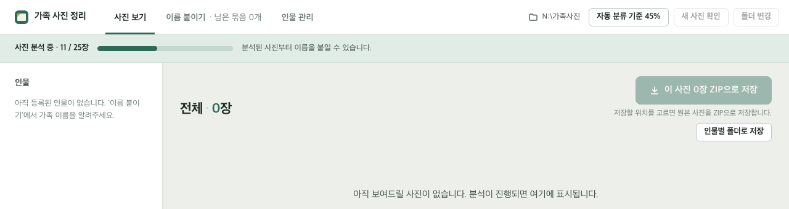
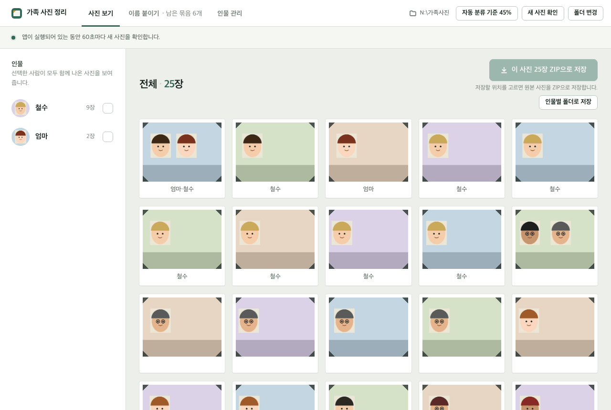
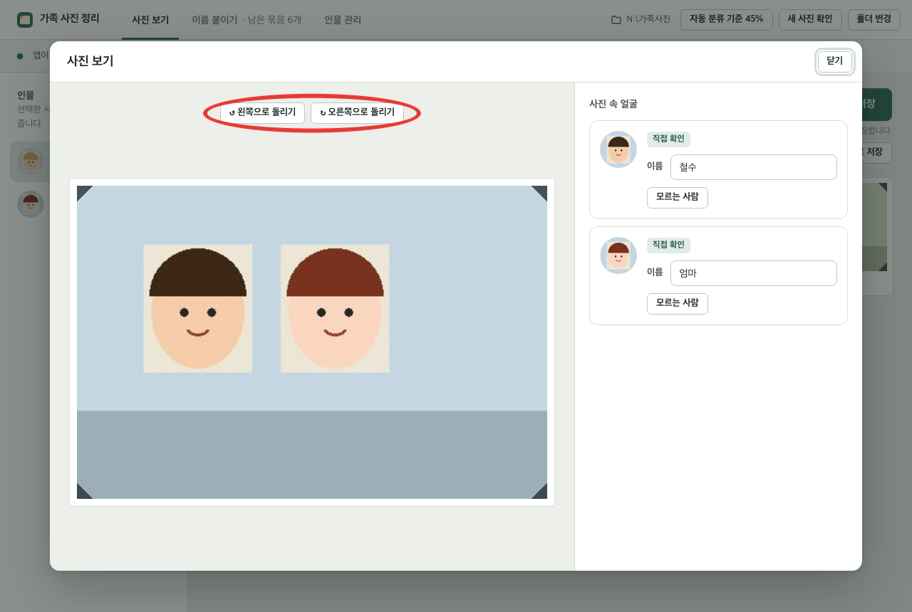

# 가족 사진 정리 (Windows)

MYBOX에 있는 가족 사진을 **사람별로 정리**해 주는 프로그램입니다. 아래 번호를 위에서부터 하나씩 그대로 따라 하세요. 굵은 글자는 화면에서 누를 버튼 이름이고, 그림의 **빨간 동그라미**가 누를 곳입니다. 처음 한 번만 30분쯤 걸립니다.

## 👉 [가족 사진 정리 프로그램 받기 (person_cluster.zip)](https://github.com/ssudaya0/family-photo-download/releases/latest/download/person_cluster.zip)

- 사진은 읽기만 합니다. 원래 사진은 바뀌거나 지워지지 않습니다.
- 모든 일은 이 컴퓨터 안에서만 합니다. 사진을 인터넷 어디로도 보내지 않습니다.

## 준비

- 인터넷이 되는 Windows 컴퓨터 (Windows 10 또는 11)
- 네이버 아이디와 비밀번호

## 1. MYBOX 설치하기

1. 이 링크를 누릅니다: [MYBOX 홈페이지 열기](https://mybox.naver.com)
2. **데스크톱 앱 다운로드**를 누릅니다.
3. **Win x64**를 누릅니다.
4. 다운로드가 끝나면 인터넷 창 오른쪽 위에 나온 받은 파일을 누릅니다.
5. **다음**을 누릅니다.
6. **설치**를 누릅니다. 물어보면 **예**를 누릅니다.
7. **다시 시작**이 나오면 누릅니다.
8. MYBOX 창에 네이버 아이디와 비밀번호를 넣고 **로그인**을 누릅니다.

## 2. 프로그램 받기

1. 맨 위의 **가족 사진 정리 프로그램 받기**를 누릅니다.
2. 다운로드가 끝나면 받은 파일 옆의 **폴더 모양**을 누릅니다.
3. 열린 창의 **person_cluster** 파일을 누른 채 **바탕 화면**으로 끌어다 놓습니다.
4. 바탕 화면의 **person_cluster** 파일을 마우스 **오른쪽 버튼**으로 누릅니다.
5. **모두 압축 풀기...**를 누릅니다.
6. **압축 풀기**를 누릅니다.

## 3. 처음 켜기

1. 바탕 화면의 노란 **person_cluster** 폴더를 두 번 누릅니다.
2. **start**를 두 번 누릅니다.
3. 파란 창이 나오면 **추가 정보**를 누르고 **실행**을 누릅니다.
4. 검은 창이 뜹니다. **닫지 말고** 5~15분 기다립니다.
5. **가족 사진 정리** 창이 뜨면 다음으로 갑니다.

## 4. 사진 폴더 고르기

1. **폴더 선택…**을 누릅니다.
2. 왼쪽에서 **MYBOX (N:)**를 누릅니다.
3. 가족 사진 폴더를 한 번 누릅니다.
4. **폴더 선택**을 누릅니다.
5. **이 폴더로 시작하기**를 누릅니다.
6. 위쪽에 숫자가 올라가며 사진을 분석합니다. 기다리지 않고 바로 다음으로 가도 됩니다.

분석이 진행되면 아래쪽에 사진이 하나씩 나타납니다.

## 5. 이름 붙이기

1. 위쪽의 **이름 붙이기**를 누릅니다.
2. 가운데에 닮은 얼굴들이 나옵니다. 다른 사람 얼굴이 있으면 그 얼굴을 한 번 눌러 체크를 풉니다.
3. 오른쪽 **이름** 칸에 이름을 씁니다.
4. **선택한 ○개에 이름 저장**을 누릅니다.
5. 다음 얼굴들이 나오면 2~4번을 다시 합니다. 모르는 얼굴이면 **이번에는 건너뛰기**를 누릅니다.
6. 아는 가족을 다 붙였으면 멈춰도 됩니다. 나머지는 프로그램이 알아서 나눕니다.

## 6. 사진 보기

1. 위쪽의 **사진 보기**를 누릅니다.
2. 왼쪽에서 사람 이름을 누릅니다. 그 사람 사진만 나옵니다.
3. 사진을 누르면 크게 보입니다. 누운 사진은 **↻ 오른쪽으로 돌리기**로 세웁니다. 닫을 때는 **닫기**를 누릅니다.
4. 보이는 사진을 모두 받으려면 **이 사진 ○장 ZIP으로 저장**을 누릅니다.
5. 저장 창에서 왼쪽 **바탕 화면**을 누르고 **저장**을 누릅니다.

## 7. 바탕 화면에 아이콘 만들기 (한 번만)

1. **person_cluster** 폴더를 엽니다.
2. **start**를 마우스 **오른쪽 버튼**으로 누릅니다.
3. **추가 옵션 표시**가 보이면 누릅니다.
4. **보내기**를 누릅니다.
5. **바탕 화면(바로 가기 만들기)**를 누릅니다.

## 다음부터 켜고 끄기

- **켜기**: 바탕 화면의 **start - 바로 가기**를 두 번 누릅니다.
- **끄기**: 가족 사진 정리 창 오른쪽 위의 **X**를 누릅니다. 붙인 이름은 자동으로 저장됩니다.
- 바탕 화면의 **person_cluster** 폴더는 **절대 지우지 마세요.** 붙인 이름이 그 안에 저장됩니다.
- 새 버전이 나오면 맨 위 링크로 다시 받아, 압축을 푼 파일을 기존 person_cluster 폴더에 덮어씁니다.

## 막히면 ChatGPT에게 물어보기

처음 한 번만 설치합니다.

1. 이 링크를 누릅니다: [ChatGPT 앱 받기 (Microsoft Store)](https://apps.microsoft.com/detail/9plm9xgg6vks?hl=ko-KR&gl=KR)
2. **받기**(또는 **설치**)를 누릅니다. Store 창이 열리면 거기서 한 번 더 누릅니다.
3. 다 깔리면 **열기**를 누릅니다.
4. **Google로 계속하기**를 누르고 구글 계정으로 로그인합니다.

물어볼 때는 이렇게 합니다.

1. 막힌 화면에서 키보드의 **Windows 키**와 **Shift**와 **S**를 함께 누릅니다.
2. 화면이 어두워지면 마우스로 화면 왼쪽 위에서 오른쪽 아래까지 끌어 놓습니다.
3. ChatGPT 창 아래의 입력 칸을 누릅니다.
4. **Ctrl**과 **V**를 함께 누릅니다. 화면 사진이 붙습니다.
5. "가족 사진 정리 프로그램을 쓰다가 이 화면이 나왔어요. 어떻게 하면 되나요?"라고 쓰고 **Enter**를 누릅니다.
6. 그래도 안 되면 화면을 휴대폰으로 찍어 자녀에게 보냅니다.

ChatGPT가 처음부터 한 단계씩 같이 해 주길 원하면, 이 페이지 주소를 ChatGPT에 붙여 넣고 "이 안내를 한 단계씩 같이 해 주세요"라고 쓰면 됩니다.

## 자주 나오는 화면

| 화면에 나온 글 | 이렇게 하세요 |
| --- | --- |
| 검은 창에 "WebView2 런타임이 필요합니다" | [WebView2 받기](https://developer.microsoft.com/microsoft-edge/webview2/)를 눌러 설치한 뒤 **start**를 다시 두 번 누릅니다 |
| "이미 실행 중인지 확인해주세요" | 화면 맨 아래 줄에서 **가족 사진 정리**를 누릅니다. 이미 켜져 있습니다 |
| "폴더를 찾을 수 없습니다" | MYBOX에 로그인이 되어 있는지 확인합니다 (1번의 8) |
| "일부 사진을 분석하지 못했습니다" | 그대로 둡니다. 1분마다 다시 해 봅니다 |
| "앱 내부 연결이 끊겼습니다" | **X**로 끄고 **start - 바로 가기**를 다시 두 번 누릅니다 |

그림 속 사진과 이름은 설명을 위해 만든 가짜입니다.
